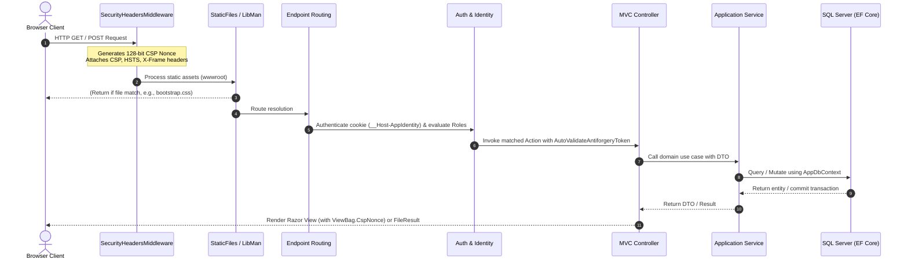

# System Architecture and Design Patterns

This document describes the architectural principles, layers, request lifecycle, and middleware pipeline of the solution.

---

## 1. Architectural Style: Clean Architecture

The solution implements **Clean Architecture** (also referred to as Onion or Ports-and-Adapters Architecture). The core premise is that business logic and domain entities are completely isolated from databases, UI frameworks, third-party libraries, and external protocols.

```
+-------------------------------------------------------+
|                    Solution.Web                       |
|   (Controllers, Razor Views, Security Middleware)     |
+-------------------------------------------------------+
                           │
                           ▼
+-------------------------------------------------------+
|              Solution.Infrastructure                  |
|    (EF Core DbContexts, ClosedXML, CsvHelper)         |
+-------------------------------------------------------+
                           │
                           ▼
+-------------------------------------------------------+
|                Solution.Application                   |
|       (Service Interfaces, DTOs, ViewModels)          |
+-------------------------------------------------------+
                           │
                           ▼
+-------------------------------------------------------+
|                  Solution.Domain                      |
|       (Entities, Value Objects, Enums, Rules)         |
+-------------------------------------------------------+
```

### Layer Responsibilities

1. **`Solution.Domain`**:
   - Contains pure C# classes representing the IAF member registry, reunion events, payments, family structures, and trades.
   - Zero framework dependencies.
   - Encapsulates domain enums and validation rules.

2. **`Solution.Application`**:
   - Defines use case abstractions through service interfaces (`IMemberService`, `IPaymentService`, etc.).
   - Holds Data Transfer Objects (DTOs) and ViewModels, preventing domain entities from leaking directly into HTTP responses or views.
   - Contains input validation definitions and business response structures.

3. **`Solution.Infrastructure`**:
   - Implements application service contracts.
   - Maps domain entities to SQL Server tables via Entity Framework Core (`AppDbContext` and `AppIdentityDbContext`).
   - Implements Excel handling via `ClosedXML` and CSV serialization via `CsvHelper`.
   - Houses seeders and database migrations.

4. **`Solution.Web`**:
   - Implements ASP.NET Core MVC controllers.
   - Emits responsive Razor views using Bootstrap 5 and standard Tag Helpers.
   - Enforces authentication, authorization, anti-forgery, and security headers.

---

## 2. HTTP Request Pipeline & Middleware Lifecycle

The request lifecycle is configured in [Program.cs](file:///e:/ProjectTemplate/src/Solution.Web/Program.cs). The pipeline executes in the following strict order:



### Detailed Middleware Stages:

1. **Exception Handling & HSTS**:
   - In production: `app.UseExceptionHandler("/Home/Error")` and `app.UseHsts()`.
   - In development: `app.UseDeveloperExceptionPage()`.
2. **Security Headers Middleware** ([SecurityHeadersMiddleware.cs](file:///e:/ProjectTemplate/src/Solution.Web/Middleware/SecurityHeadersMiddleware.cs)):
   - Injects `Content-Security-Policy` with a per-request dynamic 128-bit cryptographic nonce (`'nonce-... '`).
   - Injects `X-Frame-Options: DENY`, `X-Content-Type-Options: nosniff`, `Referrer-Policy: strict-origin-when-cross-origin`.
3. **HTTPS Redirection**:
   - Forces unencrypted requests to HTTPS (`app.UseHttpsRedirection()`).
4. **Static Assets**:
   - Serves files from `wwwroot/` with immutable caching headers where appropriate.
5. **Routing & Authentication**:
   - `app.UseRouting()`.
   - `app.UseAuthentication()` reads and decodes the secure authentication cookie (`__Host-AppIdentity`).
   - `app.UseAuthorization()` validates `[Authorize(Roles = "Admin")]` and `[Authorize(Roles = "Member")]` policies.
6. **Endpoints / MVC Controller Execution**:
   - Maps controllers with conventional routing `{controller=Home}/{action=Index}/{id?}`.

---

## 3. Separation of Contexts (Dual DbContext Pattern)

The application maintains two isolated DbContexts to uphold separation between security boundaries and business domain models:

| Context | Schema | Purpose | Models Managed |
| :--- | :--- | :--- | :--- |
| **`AppDbContext`** | `app.` | Business domain persistence | `IAF_PersonalData`, `IAF_FamilyData`, `IAF_AdditionalData`, `IAF_ReunionEvent`, `IAF_Reunion`, `IAF_Payment`, `IAF_Announcement`, `Trade`, `State` |
| **`AppIdentityDbContext`** | `auth.` | Security and authentication | `ApplicationUser`, `IdentityRole`, `IdentityUserClaim`, `IdentityUserRole`, `IdentityUserLogin`, `IdentityRoleClaim`, `IdentityUserToken` |

Both contexts connect to the same underlying database by default using the `DefaultConnection` string, but operate under completely segregated SQL schemas.

---

## 4. Design Patterns Implemented

1. **Dependency Injection (IoC)**:
   - All services, DbContexts, and loggers are injected via constructor injection.
   - Service lifecycles are registered centrally in `ServiceCollectionExtensions.cs`.
2. **Data Transfer Object (DTO) Pattern**:
   - Entities are transformed to DTOs in service classes before passing to controllers, preventing over-posting and entity state leakage.
3. **Transactional Script / Service Layer Pattern**:
   - Multi-table operations (such as Member Import or Reunion Registration) run inside explicit EF Core database transactions (`IDbContextTransaction`) with automatic rollback on error.
4. **View Component / Partial Pattern**:
   - Modular UI components (such as login bars, alert summaries, and member photo cards) are encapsulated in Razor partial views.
