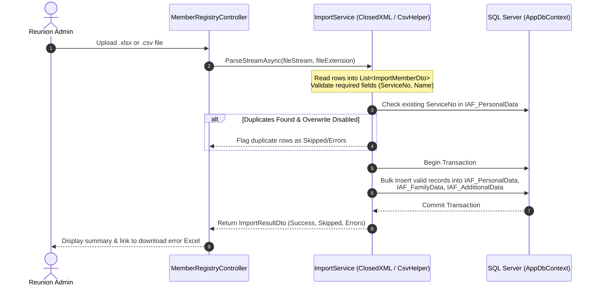
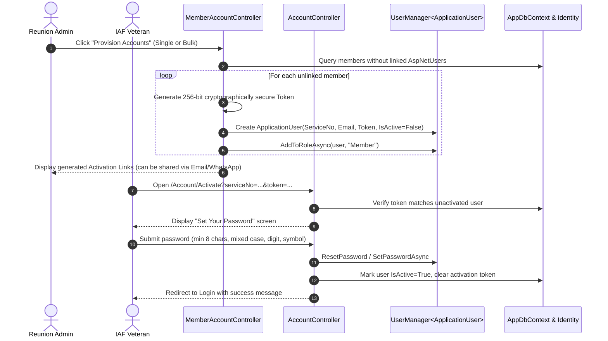
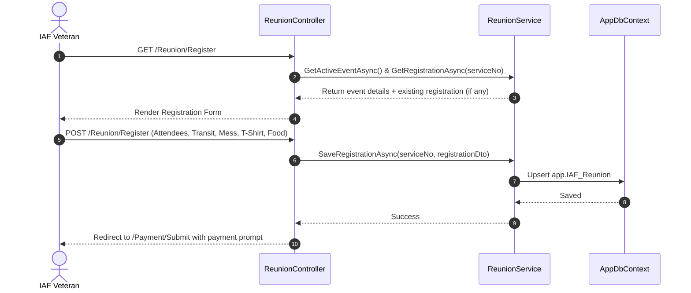
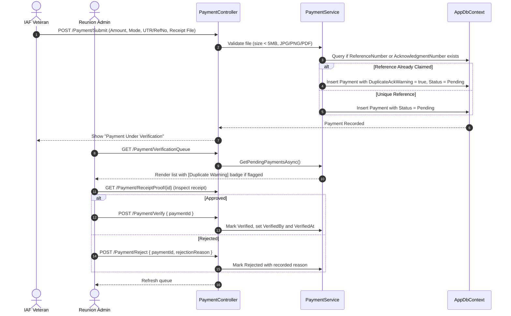

# End-to-End Business Workflows

This document describes the core operational workflows of the application, complete with step-by-step logic and sequence diagrams.

---

## 1. Member Spreadsheet Import Workflow

Administrators can bulk-import historical airmen records from Excel (`.xlsx`) or CSV files.

### Import Validation Rules:
1. **Service Number (`ServiceNo`)**: Mandatory, trimmed, uppercase. Must be unique.
2. **Member Name**: Mandatory, max 150 characters.
3. **Trade & State Codes**: Validated against `app.Trade` and `app.State` tables; if not found, stored as null or logged as non-fatal warning.
4. **Error Log Workbook**: If invalid rows exist, an in-memory ClosedXML workbook is generated and cached in `IMemoryCache` for 15 minutes, allowing immediate admin download.

---

## 2. Member Account Provisioning & Activation

To ensure security without emailing predictable default passwords, accounts use tokenized self-activation.

---

## 3. Reunion Registration & Preference Selection

Once authenticated, members register their attendance and logistics preferences.

---

## 4. Payment Submission & Administrative Verification

Fee tracking accommodates diverse Indian payment modes (UPI, NEFT, Cheque, Cash) and flags duplicate transaction references.

---

## 5. Report Generation & Streaming

Administrators can download any of the 14 reports in either `.xlsx` or `.csv` format:

1. **Request**: Admin navigates to `/Report` and clicks an export link (e.g., `/Report/ExportArrivalSchedule?format=xlsx`).
2. **Data Assembly**: `ReportService` queries `AppDbContext` using `.AsNoTracking()` and projects required fields.
3. **Stream Building**:
   - For **XLSX**: A `XLWorkbook` is created, styled with blue headers, data rows added, worksheet name sanitized to **≤ 31 characters**, and saved into a `MemoryStream`.
   - For **CSV**: A `StreamWriter` with `CultureInfo.InvariantCulture` writes header and row values via `CsvHelper`.
4. **HTTP Delivery**: The controller returns `File(stream.ToArray(), contentType, fileName)`.
