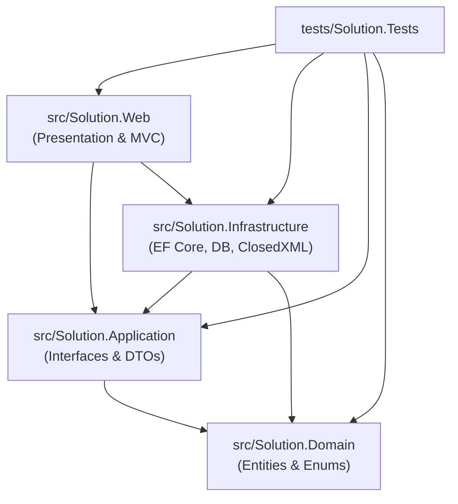

# Project Structure and Directory Hierarchy

This document details the folder structure, project dependencies, and file locations for the solution.

---

## 1. Solution Organization

The solution is organized using the modern .NET Solution file format: [Solution.slnx](file:///e:/ProjectTemplate/Solution.slnx).

```
Solution.slnx
├── Directory.Build.props              (Global compiler flags, analysis mode, nullable enable)
├── Directory.Packages.props           (Centrally managed package versions)
├── DbTable.txt                        (Original IAF SQL Server schema reference)
├── AI-KnowledgeBase/                  (Comprehensive developer and AI reference documentation)
│
├── src/
│   ├── Solution.Domain/               (Clean Architecture: Core domain, entities, enums)
│   ├── Solution.Application/          (Clean Architecture: DTOs, interfaces, business contracts)
│   ├── Solution.Infrastructure/       (Clean Architecture: EF Core, persistence, services, ClosedXML)
│   └── Solution.Web/                  (Clean Architecture: ASP.NET Core MVC, Identity, Views, Middleware)
│
└── tests/
    └── Solution.Tests/                (Clean Architecture: Unit and integration test suite)
```

---

## 2. Dependency Flow Diagram

The solution strictly enforces inward-pointing Clean Architecture dependencies:



---

## 3. Directory Breakdown by Project

### `src/Solution.Domain/`
Contains purest domain concepts with zero third-party dependencies:
- **`Entities/`**:
  - `IafPersonalData.cs`: Primary member record (ServiceNo, Name, Email, Rank, Trade, Units, Address).
  - `IafFamilyData.cs`: Marital status, spouse, children details.
  - `IafAdditionalData.cs`: Skills, awards, VRS reason, and 5 photo binary slots (`Photo1` .. `Photo5`).
  - `IafReunionEvent.cs`: Multi-event metadata (Title, dates, venue, registration fee).
  - `IafReunion.cs`: Member registration for an event (transit, mess, t-shirt, dietary).
  - `IafPayment.cs`: Payment records (mode, reference, amount, proof attachment, verification).
  - `IafAnnouncement.cs`: Bulletin notifications and reunion updates.
  - `Trade.cs`: Military trade master reference (12 trades).
  - `State.cs`: Indian state and union territory master reference (36 states/UTs).
- **`Enums/`**:
  - `IafEnums.cs`: Strongly-typed enums (`PaymentMode`, `PaymentStatus`, `TransitPoint`, `TShirtSize`, `DietaryPreference`, `BeveragePreference`).

### `src/Solution.Application/`
Contains the application business layer contracts and transfer objects:
- **`DTOs/`**:
  - `MemberDtos.cs`: `MemberDto`, `MemberSummaryDto`, `MemberFilterRequest`, `MemberCreateEditDto`.
  - `ImportDtos.cs`: `ImportMemberDto`, `ImportResultDto`, `ImportRowError`.
  - `ReunionDtos.cs`: `ReunionEventDto`, `ReunionRegistrationDto`, `ReunionSummaryDto`.
  - `PaymentDtos.cs`: `PaymentDto`, `PaymentSubmissionDto`, `PaymentVerificationDto`.
  - `DashboardDtos.cs`: `AdminDashboardDto`, `MemberDashboardDto`, `DietaryStatsDto`.
- **`Interfaces/`**:
  - `IMemberService.cs`: Member registry querying and CRUD.
  - `IImportService.cs`: Excel/CSV spreadsheet parsing, validation, and commit.
  - `IReunionService.cs`: Event lifecycle and veteran registration management.
  - `IPaymentService.cs`: Fee recording, receipt storage, and verification.
  - `IDashboardService.cs`: Metrics aggregation for admin and member portals.
  - `IReportService.cs`: 14 distinct Excel and CSV export builders.
  - `IAuditLogger.cs`: Security and operational audit logging.

### `src/Solution.Infrastructure/`
Implements interfaces, persistence, and external library integrations:
- **`Persistence/`**:
  - `AppDbContext.cs`: Application database context (`app` schema) mapping all IAF entities.
  - `AppIdentityDbContext.cs`: Security database context (`auth` schema) mapping Identity tables.
  - `DbInitializer.cs`: Automatic seeding of Trade, State, Reunion Events, and Sample Members.
  - `IdentityDataSeeder.cs`: Automatic provisioning of default `Admin` and `Member` roles.
  - `Migrations/`: EF Core migration scripts.
- **`Services/`**:
  - `MemberService.cs`: Implementation of `IMemberService`.
  - `ImportService.cs`: Implementation of `IImportService` via ClosedXML/CsvHelper.
  - `ReunionService.cs`: Implementation of `IReunionService`.
  - `PaymentService.cs`: Implementation of `IPaymentService`.
  - `DashboardService.cs`: Implementation of `IDashboardService`.
  - `ReportService.cs`: Implementation of `IReportService` with ClosedXML and CsvHelper.
  - `AuditLogger.cs`: Implementation of `IAuditLogger`.

### `src/Solution.Web/`
Hosts the presentation layer, MVC controllers, Razor views, and middleware:
- **`Controllers/`**:
  - `HomeController.cs`: Landing page with IAF veteran themes, event announcements, and portal access.
  - `AccountController.cs`: Authentication (Login, Logout, AccessDenied, ForgotPassword).
  - `MemberRegistryController.cs`: Member listing, searching, editing, photo viewing, manual addition.
  - `MemberAccountController.cs`: Tokenized single/bulk member account provisioning and activation.
  - `ReunionController.cs`: Event view, registration form, attendance management.
  - `PaymentController.cs`: Veteran payment submission, receipt upload, admin verification workflow.
  - `DashboardController.cs`: Admin metrics dashboard and Veteran personalized hub.
  - `ReportController.cs`: 14 Excel and CSV download endpoints.
- **`Views/`**:
  - `Views/Shared/`: `_Layout.cshtml`, `_LoginPartial.cshtml`, `_ValidationScriptsPartial.cshtml`.
  - View folders corresponding to each controller (`Account`, `Dashboard`, `Home`, `MemberAccount`, `MemberRegistry`, `Payment`, `Report`, `Reunion`).
- **`Middleware/`**:
  - `SecurityHeadersMiddleware.cs`: Dynamic CSP nonce generation, X-Frame-Options, HSTS, X-Content-Type-Options.
- **`Extensions/`**:
  - `ServiceCollectionExtensions.cs`: Clean DI registration for all domain/infra services and cookies.
- **`wwwroot/`**:
  - Client-side assets (CSS, JS, fonts) managed by LibMan (`libman.json`).

### `tests/Solution.Tests/`
- `IafCoreTests.cs`: Comprehensive test battery verifying Member CRUD, CSV import with duplicate detection, Reunion registration, Payment verification/rejection, all 14 Excel/CSV report streams, and database seeding.
