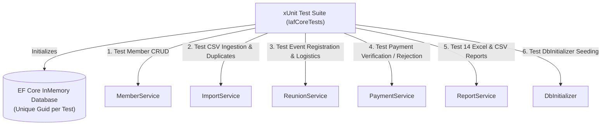

# Testing Architecture and Verification Guide

This document describes the test suite structure, patterns, coverage areas, and manual execution commands for running and validating tests.

---

## 1. Test Project Overview

The solution test suite is located in `tests/Solution.Tests/` and utilizes:
- **Test Framework**: `xunit` (v2.9.3)
- **Test Runner**: `Microsoft.NET.Test.Sdk` (v18.10.1) and `xunit.runner.visualstudio` (v3.1.5)
- **Mocking / Database Isolation**: `Microsoft.EntityFrameworkCore.InMemory` (v10.0.12)
- **Coverage**: `coverlet.collector` (v10.0.1)

---

## 2. Test Architecture: `IafCoreTests.cs`

The test suite in [IafCoreTests.cs](file:///e:/ProjectTemplate/tests/Solution.Tests/IafCoreTests.cs) provides end-to-end verification of all core modules:



### Key Test Batteries Covered:

1. **Member Registry CRUD**:
   - Asserts creating, reading, updating, and deleting an airman record with personal, family, and military data.
2. **CSV Member Import & Duplicate Detection**:
   - Streams CSV formatted rows through `ImportService`.
   - Asserts valid records are saved, while duplicate `ServiceNo` records are caught and reported in `ImportResultDto.Errors`.
3. **Reunion Registration**:
   - Registers a member for an active reunion event.
   - Verifies transit points (Airport, Central, Egmore, Tambaram), Mess accommodation flag, T-Shirt size, and dietary preference are recorded.
4. **Payment Processing & Verification**:
   - Veteran submits a payment with reference number and receipt attachment.
   - Asserts initial status is `Pending`.
   - Admin approves payment -> status updates to `Verified` with timestamp and verifier name.
   - Admin rejects payment with reason -> status updates to `Rejected` with recorded feedback.
5. **Report Generation Battery (All 14 Reports)**:
   - Iterates through all 14 report types.
   - Generates both Excel (`.xlsx`) and CSV (`.csv`) formats.
   - Asserts non-null, non-empty byte streams and verifies that OpenXML sheet names conform to the ≤ 31 character limit.
6. **Database Seeding Validation**:
   - Executes `DbInitializer.InitializeAsync`.
   - Asserts all 12 trades, 36 Indian states, and the default 40th Anniversary Reunion Event are populated.

---

## 3. Database Isolation Pattern in Tests

To guarantee tests run independently and concurrently without cross-contamination, each test method creates an isolated InMemory database using a unique database name:

```csharp
private static AppDbContext CreateInMemoryDbContext()
{
    var options = new DbContextOptionsBuilder<AppDbContext>()
        .UseInMemoryDatabase(databaseName: Guid.NewGuid().ToString())
        .Options;
    return new AppDbContext(options);
}
```

---

## 4. Manual Commands for Execution

> [!NOTE]  
> The following commands should be executed manually in a terminal by the developer to run tests, view results, or gather code coverage:

### Run All Tests:
```powershell
dotnet test tests/Solution.Tests/Solution.Tests.csproj --verbosity normal
```

### Run Tests and Collect Code Coverage:
```powershell
dotnet test tests/Solution.Tests/Solution.Tests.csproj --collect:"XPlat Code Coverage"
```

### Run a Specific Test Method:
```powershell
dotnet test tests/Solution.Tests/Solution.Tests.csproj --filter "FullyQualifiedName~Test_Member_Crud_Flow"
```

### Build Test Project Without Running:
```powershell
dotnet build tests/Solution.Tests/Solution.Tests.csproj
```
